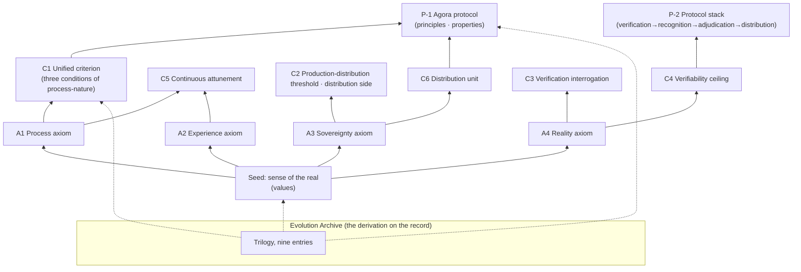

# cyano-philosophy

The core philosophy, worldview, and values of CyanoOrg — an open-source manifesto (under construction).

> **The sense of the real is the seed of value.** In an era of generative surplus, the one thing that cannot be cheaply generated is the real itself.

## System Overview

> The diagram is a projection of the canon: every node maps back to a proposition number in the text (A/C/P); it constitutes no second source of truth.

## Entries

- [axioms/en/values.md](axioms/en/values.md) — the values statement (seed and branches)
- [axioms/en/worldview.md](axioms/en/worldview.md) — the Layer-Zero canon: axioms (A1–A4) and the unified criterion, dynamics (incl. entropy-reduction economics), trend judgments
- [criteria/en/](criteria/en/) — the criteria library (c1 unified criterion ~ c6 distribution unit, six entries)
- [protocols/en/](protocols/en/) — protocol philosophy (p1 the agora protocol / p2 the protocol stack: layered iteration and adjudication)
- [evolution/en/](evolution/en/) — the philosophy evolution archive (trilogy, nine entries + appendix; sanitized originals + editor's notes)
- [wiki/en/glossary.md](wiki/en/glossary.md) — the glossary (entries anchor to canon only)
- [CHARTER.en.md](CHARTER.en.md) — revision governance charter

## Status

v0 full first draft (initiated 2026-10-23, content complete 10-27): zh-CN 23 content files all draft, awaiting owner review; **en mirror complete** (2026-10-30: 21 content entries + README/CHARTER, Locale-Sync with zh). This repository exists in the posture of a working hypothesis: every proposition must be used and tested in real products — a worldview that never intercepts a decision is a poster.

License: text CC BY-SA 4.0 + code MIT (layered; see LICENSE and tools/LICENSE)
