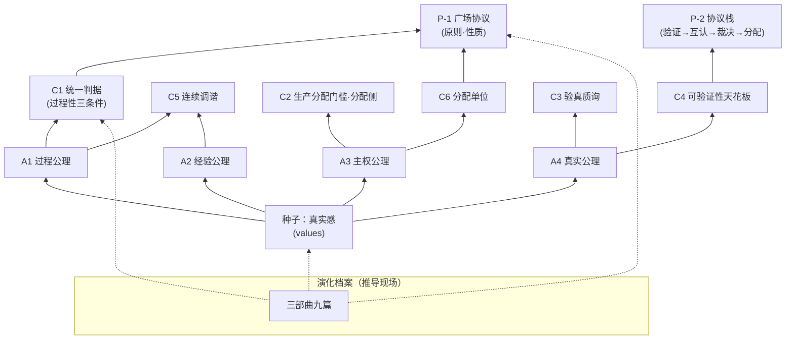

# cyano-philosophy

[English](README.md) | **中文（源语言）**

CyanoOrg 的核心哲学、世界观与价值观——开源宣言（建设中）。

> **真实感是价值的种子。** 生成过剩的时代，唯一无法被廉价生成的，是真实本身。

## 体系总览

> 图为正典投影：节点均可指回正文命题编号（A/C/P），不构成第二事实源。

## 入口

- [axioms/zh-CN/values.md](axioms/zh-CN/values.md) —— 价值观论述（种子与枝）
- [axioms/zh-CN/worldview.md](axioms/zh-CN/worldview.md) —— 第零层正典：公理（A1-A4）与统一判据、动力学（含熵减经济学）、趋势判断
- [criteria/zh-CN/](criteria/zh-CN/) —— 判据库（c1 统一判据 ~ c6 分配单位，六件）
- [protocols/zh-CN/](protocols/zh-CN/) —— 协议哲学（p1 广场协议 / p2 协议栈：迭代分层与裁决）
- [evolution/zh-CN/](evolution/zh-CN/) —— 哲学演化档案（三部曲九篇 + 附录，脱敏收录 + 编者按）
- [wiki/zh-CN/glossary.md](wiki/zh-CN/glossary.md) —— 术语表（词条只锚正典；en 镜像同步）
- [CHARTER.zh-CN.md](CHARTER.zh-CN.md) —— 修订治理条约

## 状态

v0 全量初稿（2026-10-23 立项，10-27 内容齐备）：zh-CN 侧 23 个内容文件全部 draft 待 owner 审查；**en 镜像已全量落地**（2026-10-30：21 件内容 + README/CHARTER，与 zh 同 commit 窗口同步）。本仓库以工作假设的姿态存在：每条命题须在真实产品中被使用与检验——从不参与决策的世界观只是海报。

License: 文本 CC BY-SA 4.0 + 代码 MIT（分层，见 LICENSE 与 tools/LICENSE）
