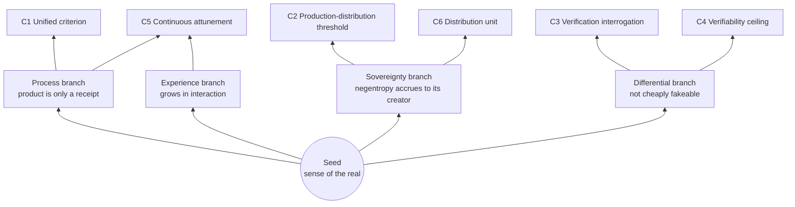

# The Sense of the Real — The Seed of Value

> **Status**: draft v0.2 · under owner review (this line is a reading note; the machine-readable status lives in the frontmatter above)

---

## The Seed

The real as felt by a person living in the world — the things you have been truly loved by, truly wounded by, truly spent time on.

It needs no definition. Everyone alive knows what it is: why an experience counts as "worth it" — what makes it worth it is never its appearance, but that it truly happened; why a work "moves" us — what moves us is never the words and pixels, but the lived process behind them.

The sense of the real is the wellspring of all value — and, in this age, the one thing in a human that cannot be replaced.

## Diagnosis: The Real Is Becoming Scarce

We have entered an age of generative surplus.

Content can be copied without limit; personas can be manufactured in batches; proof can run off an assembly line. Forgery is ten thousand times cheaper than the real — and cheaper every day.

This is not a technical problem; it is a problem of entropy: **forgery rolls with entropy; the real runs against it.** When generation becomes nearly free, the only thing that cannot be cheaply generated is the real itself — for it demands real time, real cost, real process. These cannot be compressed, and cannot be skipped.

So the anchor of value is migrating: from "looks like it's there" to "verified to be running"; from the appearance of products to the evidence of process — and finally, to the unforgeable change that process itself brings about.

## Branches from One Seed

In our practice, this seed has grown branches. They are not "aspects" of the seed — they are its unfolding.

**The Process Branch** — the real lives in the process. The product is only its receipt; mistaking the receipt for the value itself is the first misreading of the real.

**The Experience Branch** — the real grows in interaction; it does not settle in corpora. Accumulation without interaction is dead sediment; whatever is alive keeps exchanging with the world.

**The Sovereignty Branch** — the accumulation of the real (the accumulation of negentropy) belongs to those who create it. Wherever the run history lives, there the returns accumulate — not as a wish, but as the condition of ownership on which everything else depends.

**The Differential Branch** — the test of the real is the differential change that cannot be cheaply faked. Real or not: not by what it says, but by whether a real process has produced in it a change that is checkable and hard to forge.

The branches hold one another up: without process, experience has nowhere to grow; without sovereignty, accumulation has nowhere to rest; without the differential, judgment has nowhere to bite. **The seed is their common root; they are the seed's shape in this world.**

In the synthetic age, the way humans keep the real is to own their process, their experience, and their agents.

## What This Manifesto Is For

To state the seed clearly, to grow the branches strong — and then, to let them be tested.

Every statement here is held as a **working hypothesis**: it must keep being used, challenged, and revised in real products and real collaboration. A value that never informs a decision is only a poster; a manifesto that never submits to testing is only a stage set.

So we publish it — for publishing is the first step of handing it to the world to be tested.

---

*This document is the values entry point of the CyanoOrg philosophy. The branches are phrasings in the seed's register; precise mechanism terms (intelligence / negentropy / differential change, etc.) defer to [worldview.md](../en/worldview.md); revisions follow [CHARTER](../../CHARTER.en.md).*

*Locale-Sync: this en mirror of [values.md](../zh-CN/values.md) was translated in the same commit window; the zh-CN version is the source of authority.*
