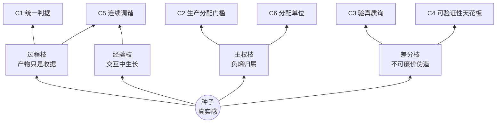

# 真实感——价值的种子

> **状态**: draft v0.2 · owner 审改中（本行为阅读提示；机器可读状态以上述 frontmatter 为准）

---

## 种子

人活在世界上所感受的真实——被真正爱过、真正受过伤、真正花过时间的那些东西。

它不需要定义。每个活着的人都知道它是什么：一段经历为什么「值得」，值得的从来不是经历的外观，是它真实地发生过；一件作品为什么「动人」，动人的从来不是文字与像素，是背后那个真实活过的过程。

真实感是一切价值感的源头，也是这个时代里，人最不可被替代的东西。

## 时代诊断：真实正在变稀缺

我们进入了一个生成过剩的时代。

内容可以被无限复制，形象可以被批量经营，证明可以被流水线制造。伪造比真实便宜一万倍——而且每一天都在变得更便宜。

这不是技术问题，是熵的问题：**伪造是顺熵的，真实是逆熵的**。当生成变得近乎免费，唯一无法被廉价生成的，就是真实本身——因为它需要真实的时间、真实的代价、真实的过程。这些无法压缩，也无法跳过。

于是价值的锚点正在迁移：从「看起来有」，到「验证过在运行」；从产物的外观，到过程的证据，最终到**因过程而变的、无法伪造的改变本身**。

## 从种子长出的枝

这颗种子，在我们的实践里长出了枝。它们不是种子的「方面」——是种子的展开。

**过程枝**：真实活在过程里。产物只是过程的收据；把收据当作价值本身，是对真实的第一次误认。

**经验枝**：真实在交互中生长，不在语料中沉淀。没有交互的积累是死的堆积；活着的东西都在持续地与世界交换。

**主权枝**：真实的积累（负熵的积累），归属创造它的人。运行史活在谁的基底上，收益就积累给谁——这不是愿望，是其他一切成立的所有权条件。

**差分枝**：真实的判定，是不可廉价伪造的差分改变。真不真，不看它说了什么，看它是否因真实的过程产生了可查证、难伪造的改变。

枝与枝互相支撑：没有过程，经验无处生长；没有主权，积累无处安放；没有差分，判定无处着力。**种子是它们共同的根，它们是种子在这个世界里的形状。**

在合成时代，人保有真实的方式，是拥有自己的过程、经验与代理。

## 这份宣言要做什么

把种子说清楚，把枝养大，然后——让它们被检验。

这里的每一条都当作**工作假设**对待：它们必须持续地在真实的产品与真实的协作中被使用、被挑战、被修正。一条从不参与决策的价值观只是海报；一份从不接受检验的宣言只是布景。

所以我们公开它——公开，就是把它交给世界检验的第一步。

---

*本文档是 CyanoOrg 哲学体系的价值观入口。枝为种子语境的展开表述，精确机制术语（智能/负熵/差分改变等）以 [worldview.md](worldview.md) 为准；修订遵循 [CHARTER](../../CHARTER.zh-CN.md)。*
