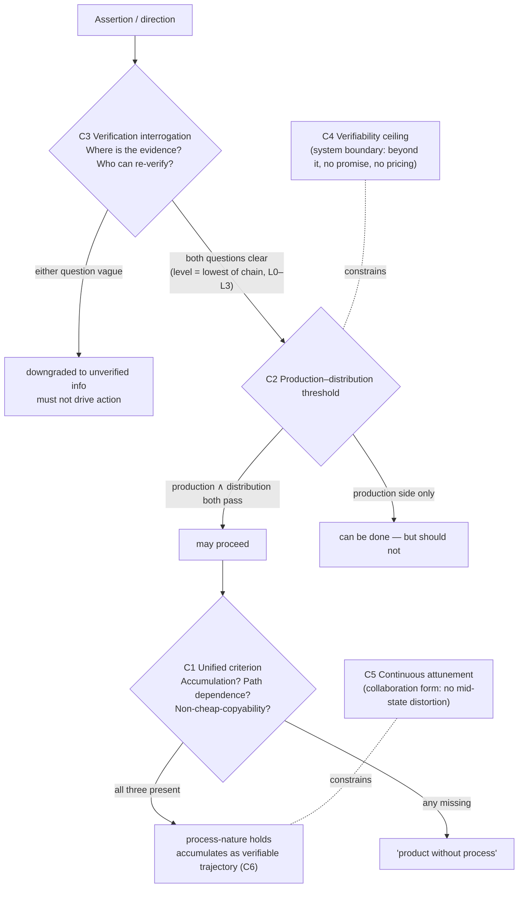

# The Criteria Library (criteria/)

> Adjudication tools distilled from practice discussions, six in all: c1 unified criterion / c2 production–distribution threshold / c3 verification interrogation / c4 verifiability ceiling / c5 continuous attunement / c6 distribution unit. Each entry: definition → judgment → origin → relation to the seed.

## Decision Flow for Using the Criteria

## Index

| # | Criterion | One sentence |
|---|---|---|
| C-1 | [Unified criterion](c1-unified-criterion.md) | Process-nature = the capacity to be changed by the process (three independently measurable conditions) |
| C-2 | [Production–distribution threshold](c2-production-distribution-threshold.md) | Production side ∧ distribution side — both gates must pass before proceeding |
| C-3 | [Verification interrogation](c3-verification-interrogation.md) | Where is the evidence + who can re-verify (L0–L3 grading) |
| C-4 | [Verifiability ceiling](c4-verifiability-ceiling.md) | A system's value is capped by its verifiability |
| C-5 | [Continuous attunement](c5-continuous-attunement.md) | The intermediate states are where the real happens |
| C-6 | [Distribution unit](c6-distribution-unit.md) | The verifiable trajectory as the basis of distribution; whatever can be copied should not be the unit |
