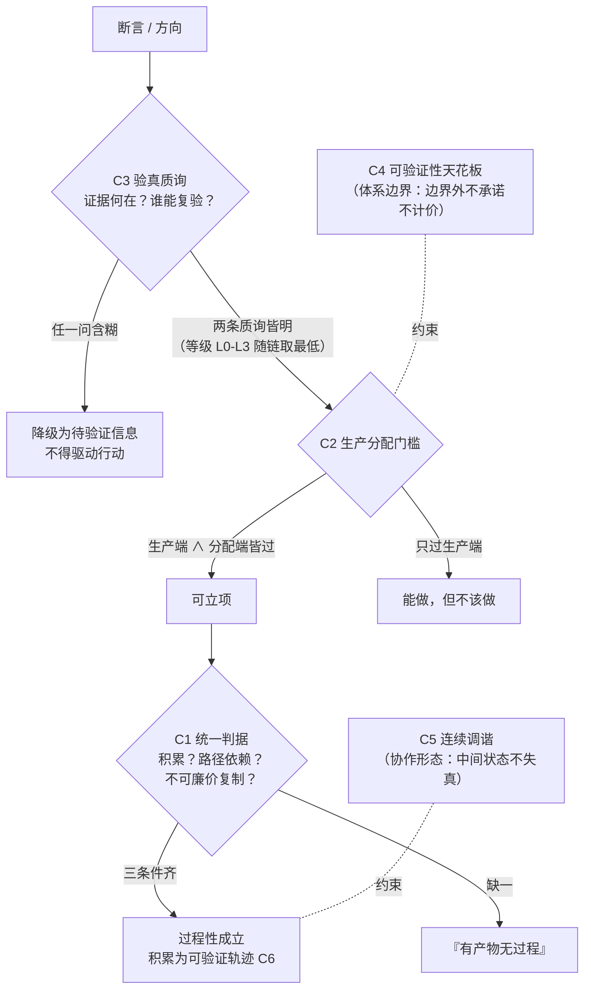

# 判据库（criteria/）

> 从实践讨论蒸馏的裁决工具，六件：c1 统一判据 / c2 生产分配门槛 / c3 验真质询 / c4 可验证性天花板 / c5 连续调谐 / c6 分配单位。每件结构：定义 → 判定 → 溯源 → 与种子的关系。

## 判据使用决策流

## 索引

| 编号 | 判据 | 一句话 |
|---|---|---|
| C-1 | [统一判据](c1-unified-criterion.md) | 过程性 = 被过程改变的能力（三条件独立可测） |
| C-2 | [生产分配门槛](c2-production-distribution-threshold.md) | 生产端 ∧ 分配端，两门同过方可立项 |
| C-3 | [验真质询](c3-verification-interrogation.md) | 证据何在 + 谁能复验（L0-L3 分级） |
| C-4 | [可验证性天花板](c4-verifiability-ceiling.md) | 体系价值由可验证性上限决定 |
| C-5 | [连续调谐](c5-continuous-attunement.md) | 中间状态是真实发生的地方 |
| C-6 | [分配单位](c6-distribution-unit.md) | 可验证轨迹为分配基准，能被拷走的都不该是分配单位 |
