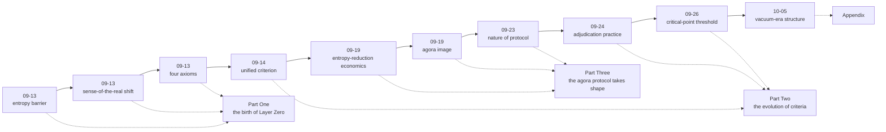

# The Evolution Archive (evolution/)

> Philosophy is discussed, refuted, and adjudicated into being — it does not fall from the sky. This directory archives the scenes where the canon formed: selected original discussion documents (sanitized; original text + editor's notes). Append-only: archive only, never rewrite history.

## Evolution Timeline

## Table of Entries (v1, proposed 2026-10-25 / settled 10-27)

### Part One · The Birth of Layer Zero

| # | Entry | Date | Editor's-note highlights |
|---|---|---|---|
| 1 | Culture as an entropy barrier | 09-13 | The founding insight: the first brick of organizational philosophy — why culture is "invisible while effective" |
| 2 | The shifting sense of the real | 09-13 | The sense-of-the-real line takes shape: the source of the pricing benchmark migration |
| 3 | The four axioms of the worldview | 09-13 | The congealing: how three lines of thought closed into four axioms |

*(The entropy-barrier v2 self-correction and the narrative-vs-capability discussion are mentioned in editor's notes; not separate entries.)*

### Part Two · The Evolution of Criteria

| # | Entry | Date | Editor's-note highlights |
|---|---|---|---|
| 4 | The unified criterion takes shape (four lines converge): process · four scales · negentropy | 09-14 | The birth of the unified criterion: the mechanization moment of the four axioms |
| 5 | The baseline for batch adjudication | 09-24 | Verification interrogation in practice: the disagreement is in evidence levels, not opinions |
| 6 | The critical-point dual threshold and the adjudication layer | 09-26 | Criteria institutionalized: from tool to institution (tiered courts) |

*(The continuous-attunement entry is a runner-up — its conclusions absorbed into c5; mentioned in editor's notes.)*

### Part Three · The Agora Protocol Takes Shape

| # | Entry | Date | Editor's-note highlights |
|---|---|---|---|
| 7 | Entropy-reduction economics | 09-19 | The economics of value: who pays the cost, to whom the returns accrue |
| 8 | Cognitive network topology and the agora | 09-19 | The agora image is born: the site where the gevulot prototype entered |
| 9 | Value distribution and the nature of protocol | 09-23 | From image to institution: the necessary properties derived axiom by axiom |

### Appendix

| # | Entry | Date | Editor's-note highlights |
|---|---|---|---|
| 10 | The structure of the vacuum period and the organization's dissolution sequence (sanitized) | 10-05 | Organizational philosophy standing alone: the coordination→adjudication→distribution dissolution sequence; power vs. density; the seedling-stage program |

## Archiving Rules

- Each entry = sanitized original + editor's note (what judgment this discussion changed at the time; where it links into the canon)
- Sanitization at the whole repository's strictest level: private names / internal toolchains / unreleased product names / agent-collaboration details must all be removed
- File naming: <YYYY-MM-DD>-<slug>.md (chronological, matching the source discussion dates)
- Related documents not selected (the systematic-review draft = panoramic index; sound field and projection; the double-loop framework, etc.) are in the editor's-note citation pool; not separate entries
