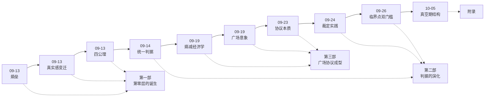

# 演化档案（evolution/）

> 哲学是被讨论、被反驳、被裁决出来的——不是掉下来的。本目录收录正典形成的现场：精选的原始讨论文档（脱敏收录，原文+编者按）。append-only：只归档，不改写历史。

## 演化时间线

## 篇目单（v1，2026-10-25 提案 / 10-27 落定）

### 第一部 · 第零层的诞生

| # | 篇目 | 日期 | 编者按要点 |
|---|---|---|---|
| 1 | 文化作为熵垒 | 09-13 | 起点洞察：组织哲学的第一块砖——为什么文化「有效时隐形」 |
| 2 | 真实感的变迁 | 09-13 | 真实感线成型：定价基准迁移的源头 |
| 3 | 世界观四公理 | 09-13 | 凝结现场：三条思想线如何合拢为四条公理 |

*（熵垒 v2 的自我修正、叙事 vs 能力两篇在编者按中提及，不占篇目）*

### 第二部 · 判据的演化

| # | 篇目 | 日期 | 编者按要点 |
|---|---|---|---|
| 4 | 统一判据成形（四线汇合）：过程·四尺度·负熵 | 09-14 | 统一判据诞生：四公理的机制化时刻 |
| 5 | 批量裁定的基准 | 09-24 | 验真质询的实践现场：分歧不在观点在证据等级 |
| 6 | 临界点双门槛与裁决层 | 09-26 | 判据的制度化：从工具到制度（分级法院） |

*（实时调谐篇为备选——其结论已收编 c5，此处编者按提及）*

### 第三部 · 广场协议成型

| # | 篇目 | 日期 | 编者按要点 |
|---|---|---|---|
| 7 | 熵减经济学 | 09-19 | 价值经济学基础：成本谁付、归属给谁 |
| 8 | 认知网络拓扑与广场 | 09-19 | 广场意象诞生：gevulot 原型的引入现场 |
| 9 | 价值分配与协议本质 | 09-23 | 从意象到制度：必要性质逐条从公理推出 |

### 附录

| # | 篇目 | 日期 | 编者按要点 |
|---|---|---|---|
| 10 | 真空期结构与组织解体时序（脱敏版） | 10-05 | 组织哲学的独立成段：协调→裁决→分配的解体时序；功率 vs 密度；萌芽期纲领 |

## 收录规范

- 每篇 = 脱敏原文 + 编者按（这段讨论当时改变了什么判断、与哪条正典衔接）
- 脱敏等级全仓最高：私人人名/内部工具链/未公开产品名/agent 协作细节必除
- 文件名：<YYYY-MM-DD>-<slug>.md（编年式，与源讨论日期一致）
- 未入选的关联文档（系统性评审草案=全景索引、声场与投影、双环框架等）在编者按引用池，不占篇目
