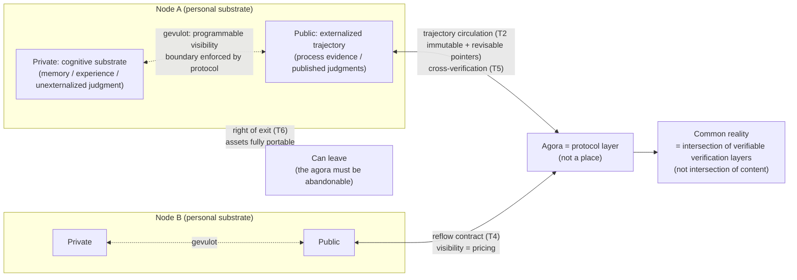

# P-1 The Agora Protocol

## Definition

**The agora is a protocol, not a place.** The public layer of a cognitive co-creation network is carried by protocol, not by platform.

**The new commonality = shared verification, not shared content.** No one can share their full information flow, and no one should share only what an algorithm picks; what can be shared is the process of verification — independent verification records of the same fact, cross-checked between agents. **Common reality = the intersection of mutually verifiable verification layers, not the intersection of content.**

The question the agora protocol answers: how do multiple cognitive agents collaborate toward the real, without surrendering cognitive sovereignty?

## Agora Principles

1. **Layered visibility (the gevulot principle, T1)**: the visibility of every cognitive asset is programmable and negotiated per context — private (memory, experience, unexternalized judgment) and public (process evidence, published judgments) are physically separated; **the boundary is enforced by protocol, not by platform policy**.
2. **Immutable trajectories + revisable pointers (T2)**: the unit of circulation is the verifiable trajectory (append-only; rewriting history = forging process = forfeiting trust); the consensus pointer is an independent, movable layer — conclusions may be overturned by new evidence, the path of approach may not be tampered with. Isomorphic to git: commits are immutable, HEAD moves.
3. **Consensus weight = process reputation (T3)**: the weight of a judgment is set by its verifiable process record — not by identity, popularity, or compute.
4. **Reflow contract (T4)**: the attribution of co-created negentropy is built into the protocol — revenue share is a protocol property, not a platform favor. Working rule: **visibility = the pricing function** — how much process you open determines how much distribution you join; opening is neither moral duty nor platform coercion, it is the bid for entering the reflow (sovereignty and distribution are two faces of one mechanism). **Metering constraint (the anti-performance principle)**: distribution metering must not weight on visibility as such — trajectory length or volume opened (volume can be watered at near-zero cost); the metering mechanism itself is subject to minimality (any metric becomes a new performance surface); concrete metering is left to each domain's practice.
5. **Mutual verifiability (T5)**: any node can verify the process evidence behind any "consensus" — unverifiable claims carry no consensus weight (verification interrogation, protocolized).
6. **Right of exit (the anti-Sobornost insurance, T6)**: a node may leave carrying all its assets (memory, trajectory replicas, reputation records) — **the agora must be abandonable, or it becomes a prison.** Mandatory data portability is a hard clause of the protocol.

## Necessary Properties of the Protocol (derived axiom by axiom)

| Property | Derived from | Content |
|---|---|---|
| **① Trajectory** | Process axiom | The data unit is the trajectory, not the snapshot; append-only. **Applies recursively to the protocol itself**: the protocol's version history must be a trajectory — evolution by append only, no restarts, no redesigns (those who wanted to restart HTML died; the living standard lives) |
| **② Minimality** | Experience axiom | Intelligence grows in interaction → the protocol must leave maximal room for emergence → **fewest conventions, most emergence**. A protocol is not the expression of its designer's wisdom but the soil an ecosystem grows in — **the virtue of soil is barrenness, not fertility** |
| **③ Forkability** | Sovereignty axiom | No node holds final interpretive authority; right of exit (assets fully portable) + right to fork (a dissenting group may take the whole protocol away). **The protocol must allow its own opposition to exist — written into its own constitution** |
| **④ Built-in verification** | Reality axiom | Key claims independently verifiable by third parties; the root of trust is mathematics (asymmetric signatures), not institutions. Priority: **better weak in function than weak in verification** — every distribution and consensus on a forgeable protocol will be corroded by sybil attacks |
| **⑤ Metabolism** | Entropy-reduction economics | The protocol is a dissipative structure, not a monument: without governance energy and funding streams it must entropy-increase (bloat, politics, compatibility baggage). Built-in retirement channels + **maintenance costs made explicit** (who pays the entropy-reduction bill is written at design time). A protocol without a built-in funding stream dies of maintainer exhaustion |

## Closing: The Protocol Must Be Able to Die

Push the five properties to their end: **the protocol must retain the freedom to be replaced, forked, and to die — a protocol that does not allow its own death will itself grow into Sobornost.**

The first-generation protocol will most likely die, but **the testament clauses are written in advance** (open data formats, documented migration paths) — a dead protocol must be inheritable by trajectory, as dead individuals leave their experience to the species.

## Literary Prototypes: gevulot and Sobornost

A matched pair of settings from *The Quantum Thief* (Rajaniemi):

- **gevulot** (the privacy protocol of the Oubliette): "public and private are not two spaces but programmable frequency bands of each person" — in a society of default sharing, individuals draw boundaries by protocol, openly and negotiably. → The prototype of principle 1: voluntary layered sharing.
- **Sobornost** (the collective that forcibly copies minds): individual cognition replicated, homogenized, finally absorbed into a central will — the ultimate form of platform capture, a refinery of cognition. → The warning behind "the protocol must be able to die": the endgame of forced total sharing.

Two civilizations, two forks: voluntary layered sharing vs. forced total sharing — the sovereignty axiom's positive and negative exemplars at science-fiction scale.

## Long-Term Clauses

- **Commons pool / commons tax**: part of the emergent value (the excess of the whole over the sum of parts) reflows into a commons pool, specifically pricing **maintenance-grade entropy reduction** (documentation, maintenance, arbitration, education — contributions with no direct consumption value but necessary for the network's survival) — if the distribution mechanism does not pay for maintenance, the network is eaten hollow by consumptive contributions. (Adopted in principle; engineering deferred.)

## Origin

2026-09 cognitive co-creation network discussion series (network topology → organizational prototypes → the nature of protocol); principle-layer ruling on 2026-09-24.

## Relation to the Seed

The public face of the sovereignty and differential branches: the agora protocol defines "how the accumulation of the real is shared without surrendering sovereignty" — layered visibility (gevulot) is the protocol form of the sovereignty branch; mutual verifiability and the reflow contract are the differential branch's landing in the public layer.
