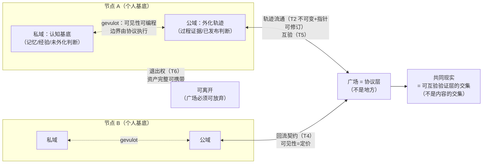

# P-1 广场协议

## 定义

**广场是协议，不是地方。** 认知共创网络的公共层由协议承载，不由平台承载。

**新公共性 = 验证的共享，不是内容的共享。** 没人能共享全部信息流，也不该只共享算法挑的；可以共享的是验证过程——各主体对同一事实的独立验证记录互验。**共同现实 = 可互验验证层的交集，不是内容的交集。**

广场协议回答的问题：多个认知主体，如何不交出认知主权而协作逼近真实？

## 广场原则

1. **分层可见性（gevulot 原则，T1）**：每份认知资产的可见性可编程、随语境协商——私域（记忆、经验、未外化判断）与公域（过程证据、已发布判断）物理分离，**边界由协议执行，不由平台政策执行**。
2. **轨迹不可变 + 指针可修订（T2）**：流通单元是可验证轨迹（append-only，改写历史=伪造过程=失信）；共识指针独立一层可移动——结论可被新证据推翻，逼近路径不可篡改。与 git 同构：commits 不可变，HEAD 可移动。
3. **共识权重 = 过程信誉（T3）**：判断的分量由可验证过程履历决定，不由身份、人缘或算力决定。
4. **回流契约（T4）**：共创负熵的归属分配内置于协议——分成是协议属性，不是平台恩赐。展开细则：**可见性 = 定价函数**——公开多少过程，参与多少分配；公开不是道德义务或平台强制，是进入回流的报价（主权与分配是同一机制的两面）。
5. **互验性（T5）**：任何节点可验证任何「共识」背后的过程证据——不可验的主张无共识权重（验真质询的协议化）。
6. **退出权（反 Sobornost 保险，T6）**：节点可携带全部资产（记忆、轨迹副本、信誉记录）离开——**广场必须可放弃，才不会变成监狱。** 强制数据可携带是协议的硬条款。

## 协议必要性质（从公理逐条推出）

| 性质 | 推理源 | 内容 |
|---|---|---|
| **① 轨迹性** | 过程公理 | 数据单位是轨迹非快照；append-only。**递归适用于协议自身**：协议版本史必须是轨迹——只能演化追加，不能重启重设计（想重启 HTML 者死，living standard 活着） |
| **② 最小性** | 经验公理 | 智能在交互中生长 → 协议必须给涌现留最大空间 → **约定最少，涌现最多**。协议不是设计师智慧的表达，是生态生长的土壤——**土壤的德性是贫瘠而非肥沃** |
| **③ 可分叉性** | 主权公理 | 无节点有最终解释权；退出权（资产完整可携带）+ 分叉权（不满群体可带整个协议走）。**协议必须允许自己的反对者存在，且写进自己宪法** |
| **④ 验证内建** | 真实公理 | 关键声明可被第三方独立验证，信任根是数学（非对称签名）非机构。优先级：**宁可功能弱，不可验证弱**——可伪造协议上的一切分配与共识必被女巫攻击腐蚀 |
| **⑤ 代谢性** | 熵减经济学 | 协议是耗散结构非纪念碑：无治理能量与资金流维持必熵增（膨胀/政治/兼容包袱）。内置淘汰通道 + **维持成本显性化**（协议设计时就写好熵减账单谁付）。无内置资金流的协议死于维护者耗尽 |

## 合拢：协议必须可死

五条推到底：**协议必须保留自己被替代、被分叉、被死亡的自由——不允许自己死亡的协议，自己会长成 Sobornost。**

第一代协议大概率死，但**遗嘱条款预先写好**（数据格式开放、迁移路径文档化）——死的协议要能被继承轨迹，如死的个体把经验留给物种。

## 文学原型：gevulot 与 Sobornost

出自《量子窃贼》（Rajaniemi）的一对正反设定：

- **gevulot**（忘川城隐私协议）：「公与私不是两个空间，是每个人可编程的频段」——默认共享的社会里个体用协议划界，边界公开可协商。→ 广场特点 1 的原型：自愿分层共享。
- **Sobornost**（强制拷贝意志的集体）：个体认知被复制、同质化、终归于中心意志——平台捕获的终极形态，认知的炼油厂。→ 协议必须可死的警告：强制全共享的终局。

两文明即两岔路：自愿分层共享 vs 强制全共享——主权公理在科幻尺度上的正反例。

## 远期条款

- **公共池/公地税**：涌现价值（网络整体 > 部分之和的差额）部分回流公共池，专门定价**维护性熵减**（文档、维护、仲裁、教育等无直接消费价值但对网络存续必要的贡献）——分配机制不给维持成本买单，网络被消费性贡献吃空。（原则层已批，暂不工程化）

## 溯源

2026-09 认知共创网络系列讨论（网络拓扑 → 组织原型 → 协议本质），原则层裁定于 2026-09-24。

## 与种子的关系

主权枝与差分枝的公共面：广场协议定义「真实的积累如何在不交出主权的前提下共享」——分层可见性（gevulot）是主权枝的协议形态，互验性与回流契约是差分枝的公共层落地。
