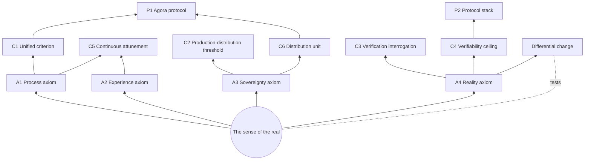

# Glossary

> The terminology SSOT of the CyanoOrg philosophy system — one entry per term: term + definition + canon anchor. zh-CN is the source language; this mirror follows the Locale-Sync rule. **Reading note**: the brackets 〔〕 mark canon anchors (format spec in the root .norm anchor_format); section names use localized forms (Seed · 枝 · red line). **Coverage boundary**: entries anchor to canon only — concepts not yet canonized (living in the evolution archive) gain entries upon canonization.

## Core Term Network

## Seed and Structure

**Sense of the real** — the real as felt by a person living in the world; the seed of all value. 〔values · Seed〕

**Seed and branches** — the structure of the values: the sense of the real is the entry point of empathy (the seed); the four axioms are its unfolding (the branches). The seed does not swallow the branches; the branches do not pretend to be the root. 〔values · Branches; CHARTER · red line〕

**The synthetic age** — the era in which generation is nearly free and forgery rolls with entropy; the real becomes scarce and becomes the anchor of value. 〔values · Diagnosis〕

## The Four Axioms and Their Constituents

**Process axiom** — value lives in the process; the product is only a receipt. 〔worldview · A1〕 The values manifesto registers this as the "Process branch": the real lives in the process; mistaking the receipt for the value is the first misreading of the real. 〔values · Branches〕

**Experience axiom** — intelligence grows in interaction, not in corpora. 〔worldview · A2〕 The manifesto's "Experience branch": accumulation without interaction is dead sediment. 〔values · Branches〕

**Sovereignty axiom** — sovereignty = the claim over accumulated negentropy. 〔worldview · A3〕 The manifesto's "Sovereignty branch": the accumulation of the real belongs to those who create it. 〔values · Branches〕

**Reality axiom** — the real = differential change that cannot be cheaply faked. 〔worldview · A4〕 The manifesto's "Differential branch": judged not by what is said, but by checkable, hard-to-forge change. 〔values · Branches〕

**Negentropy accumulation** — the net growth of order; the unit of account for sovereignty. 〔worldview · A3; worldview · §3〕

**Differential change** — a change in behavior caused by the process itself, counterfactually checkable; the standard for judging the real, as distinct from forgeable temporal evidence. 〔worldview · A4; values · differential branch〕

## Dynamics

**Entropy barrier** — culture and norms as dissipative structures: they do not produce trust, they retard its dissipation; invisible while effective; half-maintained ≈ not maintained. 〔worldview · §3〕

**Dissipative structure** — a form of order sustained by continuous work; degrades upon the cessation of effort. 〔worldview · §3〕

**Path dependence** — the property that state changes cannot be transplanted by snapshot; one of the necessary conditions of processuality. 〔c1 · Judgment〕

**Entropy-reduction cost transfer** — what gets pressed into a system is the past tense of skill (the structurable part); the present progressive (judgment, taste, sense of direction) does not press in. And the transfer is a change of form — it incurs two new bills: structure tax and maintenance. 〔worldview · §3〕

**Ceiling of automatic entropy reduction** — as far as verifiability reaches, so far can entropy reduction be automated: closed domains can be fully automated; open domains only maintenance-automatically (they cannot originate new directions of order-reduction); "a system generating its own purposes = a change of species, not a ceiling". 〔worldview · §3〕. **Disambiguation**: same root as the verifiability ceiling (c4) but a different layer — c4 bounds a system's value; this bounds its automation.

## Trends

**Pricing benchmark migration** — the market's judgment of "the real" is migrating: product appearance → process evidence → differential change. 〔worldview · §4〕

**Incident-to-learning conversion rate** — the true invariant; faking duration is cheap, faking learning is expensive. 〔worldview · §4〕

## Criteria

**Unified criterion** — processuality = the capacity to be changed by the process; accumulation / path dependence / non-cheap-copyability, three independently testable conditions. 〔c1 · Definition〕

**Production–distribution threshold** — production-side (can it be made) ∧ distribution-side (do the returns accrue rightly); both gates must pass. 〔c2 · Definition〕

**Verification interrogation** — where is the evidence (firsthand or relayed) + who can re-verify (independent or self-attested). 〔c3 · Definition〕

**Verifiability ceiling** — a system's value is bounded by its verifiability; beyond the boundary, promise nothing and price nothing. 〔c4 · Definition〕

**Continuous attunement** — collaborative state-sync trends toward continuity rather than discrete handoffs; the intermediate states are where the real happens. 〔c5 · Definition〕

**Verifiable trajectory** — append-only process records + verification receipts + differential history; the base unit of circulation and distribution. 〔c6 · Definition〕

**Verification level** — L0 secondhand / L1 existence / L2 firsthand content / L3 independent re-verification; the level of a citation chain is the level of its lowest link. 〔c3 · J〕. **Disambiguation**: the adjudication layer's tiered courts also use L0–L3 — that scheme grades dispute-handling, a different domain from evidence grading.

**Distribution unit** — value distribution in the cognitive co-creation network takes the verifiable trajectory as its base unit, not the product snapshot; whatever can be copied away should not be the unit of distribution. 〔c6 · Definition〕

## Protocols

**Agora** — the public layer of the cognitive co-creation network; the agora is a protocol, not a place. 〔p1 · Definition〕

**Shared verification** — the new commonality: what is shared is the process of verification, not content; common reality = the intersection of mutually verifiable verification layers. 〔worldview · §5; p1 · Definition〕

**gevulot** — from *The Quantum Thief*: public and private are not two spaces but everyone's programmable bands; extended to the layered-visibility principle — the boundary is enforced by protocol, not by platform policy. 〔p1 · T1〕

**Sobornost** — from *The Quantum Thief* (the term originates in Russian Orthodox "unity of minds"): a collective that forcibly copies wills; extended to the terminal form of platform capture — the agora must be abandonable, or it becomes a prison. 〔p1 · Literary prototype〕

**Reflow covenant** — the distribution of co-created negentropy is built into the protocol; disclose as much process as you wish to participate in distribution. 〔p1 · T4〕

**Tiered courts** — the adjudication layer's dispute-handling grades: L0 automatic → L1 reconciliation → L2 arbitration network (reputation-drawn lots, humans retain final veto) → L3 legal system; each tier an order of magnitude cheaper, the upper tier the appellate court of the lower. 〔p2 · Adjudication〕. **Disambiguation**: same L0–L3 notation as verification levels but a different domain — courts grade disputes, verification levels grade evidence.

**Necessary properties** — derived clause-by-clause from the axioms: **trajectory** (the data unit is the trajectory, not the snapshot; applies recursively to the protocol itself) / **minimality** (fewest conventions, most emergence — the virtue of soil is barrenness, not fertility) / **forkability** (the protocol must allow its own opposition to exist, written into its constitution) / **built-in verification** (better weak in function than weak in verification) / **metabolism** (the protocol must be able to die; maintenance costs made explicit). 〔p1 · Properties〕

**Layered iteration** — the protocol's growth path: verification → mutual recognition → adjudication → distribution; each layer presupposes the previous; none may be skipped. 〔p2 · Layered iteration〕

**Minimal court-entry rate** — the adjudication layer's first design goal: the stronger the first two layers, the fewer and smaller the disputes that reach adjudication; the mark of a good court is not many cases. 〔p2 · Adjudication〕

## Governance

**Working hypothesis** — the posture of the canon: to be used, challenged, and revised; a worldview that never intercepts a decision is a poster. 〔worldview · §7; CHARTER · Revision thresholds〕

**Anti-dogma** — every axiom must maintain at least one live product mapping (evidence lives in the product repos); an axiom that loses its mapping enters "under examination". 〔CHARTER · red line〕
