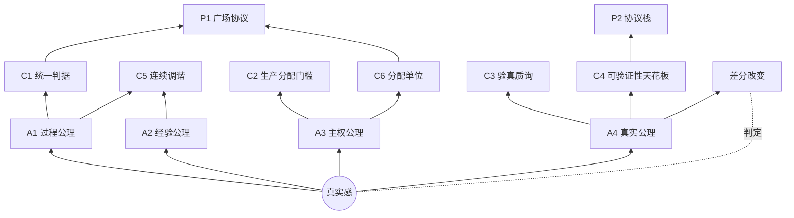

# 术语表（glossary）

> CyanoOrg 哲学体系的核心术语 SSOT——一词一条：中文术语 + 英文候选 + 一句定义 + 正典锚（格式规范见根 .norm anchor_format）。英文候选是 en 镜像翻译的锚点。**收录边界：词条只锚正典**——未正典化的概念（活在演化档案）待正典收编后再立词条。

## 核心术语网络

## 种子与结构

**真实感**（sense of the real）——人活在世界上所感受的真实；一切价值感的种子。〔values·种子〕

**种子与枝**（seed and branches）——价值观结构：真实感为共情入口（种子），公理为其在世界里的展开（枝）；种子不吞并枝，枝不假装自己是根。〔values·枝；CHARTER·红线〕

**合成时代**（the synthetic age）——生成近乎免费、伪造顺熵的时代背景；真实因此变稀缺、成价值锚点。〔values·时代诊断〕

## 公理及其构件

**过程公理**（process axiom）——价值在过程，产物只是收据。〔worldview·A1〕values 宣言称「过程枝」：真实活在过程里，产物只是过程的收据，把收据当价值本身是对真实的第一次误认。〔values·枝〕

**经验公理**（experience axiom）——智能在交互中生长，不在语料中沉淀。〔worldview·A2〕values 宣言称「经验枝」：真实在交互中生长；没有交互的积累是死的堆积。〔values·枝〕

**主权公理**（sovereignty axiom）——主权 = 负熵积累的归属权：运行史活在谁的基底上，收益就积累给谁。〔worldview·A3〕values 宣言称「主权枝」：真实的积累归属创造它的人。〔values·枝〕

**真实公理**（reality axiom）——真实 = 不可廉价伪造的差分改变。〔worldview·A4〕values 宣言称「差分枝」：真实的判定——不看说了什么，看是否因真实的过程产生了可查证、难伪造的改变。〔values·枝〕

**负熵积累**（negentropy accumulation）——秩序的净增长；主权的计量对象。〔worldview·A3；worldview·§3〕

**差分改变**（differential change）——因过程而变的、反事实可查的行为改变；真实的判定标准，区别于可伪造的时间性证据。〔worldview·A4；values·差分枝〕

## 动力学

**熵垒**（entropy barrier）——文化/规范作为耗散结构：不生产信任，延缓信任耗散；有效时隐形，半维护≈不维护。〔worldview·§3〕

**耗散结构**（dissipative structure）——靠持续做功维持的秩序形态；停止做功即降解。〔worldview·§3〕

**路径依赖**（path dependence）——状态改变无法被快照搬运的性质；过程性的必要条件之一。〔c1·判定〕

**熵减成本转移**（entropy-reduction cost transfer）——压入系统的是技能的过去时（可结构化部分），现在进行时（判断/品味/目标感）压不进去；且转移是形态转换——产生结构税与维持账单两笔新账。〔worldview·§3〕

**自动熵减天花板**（ceiling of automatic entropy reduction）——可验证性到哪，自动熵减就能到哪：封闭域可彻底自动，开放域只能维持性自动（不能原创减熵方向）；「系统自生成目的=换物种问题，不是天花板问题」。〔worldview·§3〕。**辨析**：与 c4 可验证性天花板同源不同层——c4 讲体系价值上限，本条讲自动化边界。

## 趋势

**定价基准迁移**（pricing benchmark migration）——市场对「真实」判定的迁移：产物外观 → 过程证据 → 差分改变。〔worldview·§4〕

**事故→学习转化率**（incident-to-learning conversion rate）——真正的不变量；伪造时长便宜，伪造学习贵。〔worldview·§4〕

## 判据

**统一判据**（unified criterion）——过程性 = 被过程改变的能力；积累/路径依赖/不可廉价复制三条件独立可测。〔c1·定义〕

**生产分配门槛**（production–distribution threshold）——生产端（做得出）∧ 分配端（归得清）两门同过方可立项。〔c2·定义〕

**验真质询**（verification interrogation）——证据何在（一手还是转述）+ 谁能复验（独立还是自证）。〔c3·定义〕

**可验证性天花板**（verifiability ceiling）——体系价值由可验证性上限决定；边界外不承诺不计价。〔c4·定义〕

**连续调谐**（continuous attunement）——协作状态同步趋向连续而非离散交接；中间状态是真实发生的地方。〔c5·定义〕

**可验证轨迹**（verifiable trajectory）——append-only 的过程记录+验证收据+差分历史；流通与分配的基准单位。〔c6·定义〕

**验证等级**（verification level）——L0 二手 / L1 存在性 / L2 内容一手 / L3 独立复验；引用链取最低。〔c3·J〕。**辨析**：裁决层的分级法院也用 L0-L3 记号——那套分的是争议处理层级，与本条的证据分级不同域。

**分配单位**（distribution unit）——认知共创网络的价值分配以可验证轨迹为基准单位，非产物快照；能被拷走的都不该是分配单位。〔c6·定义〕

## 协议

**广场**（agora）——认知共创网络的公共层；广场是协议不是地方。〔p1·定义〕

**验证共享**（shared verification）——新公共性：共享的是验证过程而非内容；共同现实 = 可互验验证层的交集。〔worldview·§5；p1·定义〕

**gevulot**——出自《量子窃贼》：公与私不是两个空间，是每个人可编程的频段；被引申为分层可见性原则——边界由协议执行，不由平台政策执行。〔p1·T1〕

**Sobornost**——出自《量子窃贼》（词源为俄东正教「同心同意」概念）：强制拷贝意志的集体；被引申为平台捕获的终极形态——广场必须可放弃才不会变成监狱。〔p1·文学原型〕

**回流契约**（reflow covenant）——共创负熵的归属分配内置于协议；公开多少过程，参与多少分配。〔p1·T4〕

**分级法院**（tiered courts）——裁决层的争议处理分级：L0 自动裁决→L1 对账裁决→L2 仲裁网络（信誉抽签、人保留终审否决）→L3 法律系统；每层成本低一个量级，上层为下层的上诉法院。〔p2·裁决层〕。**辨析**：与验证等级的 L0-L3 记号同形不同域——分级法院分争议处理，验证等级分证据强度。

**协议必要性质**（five necessary properties）——从公理逐条推出：**轨迹性**（数据单位是轨迹非快照，递归适用于协议自身）/ **最小性**（约定最少涌现最多——土壤的德性是贫瘠而非肥沃）/ **可分叉性**（协议必须允许自己的反对者存在，写进宪法）/ **验证内建**（宁可功能弱，不可验证弱）/ **代谢性**（协议必须可死，维持成本显性化）。〔p1·必要性质〕

**迭代分层**（layered iteration）——协议的生长路径：验证→互认→裁决→分配；每层以前层为前提，四层不可跳。〔p2·迭代分层〕

**最小入庭率**（minimal court-entry rate）——裁决层的第一设计目标：前两层越强，进入裁决的争议越少越小；好法院的标志不是判案多。〔p2·裁决层〕

## 治理

**工作假设**（working hypothesis）——正典的姿态：被使用、被挑战、被修正；从不拦截决策的世界观是海报。〔worldview·§7；CHARTER·分层修订门槛〕

**反教条**（anti-dogma）——每条公理须维持至少一个活的产品映射（证据在产品仓库），失映射进入待检验。〔CHARTER·红线〕
